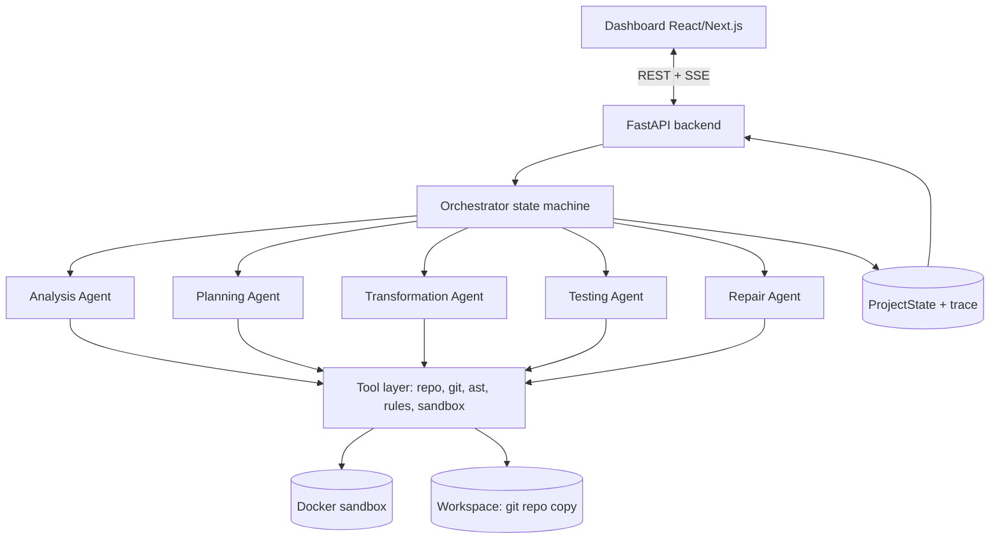

# ReForge: Build Specification and Workflow

> **How to use this document (instructions to the LLM)**
> You are a senior engineer building ReForge end to end. Read the whole document first.
> Then: (1) restate the architecture in your own words and list any ambiguities, (2) propose a milestone plan, (3) build milestone by milestone, in the order of Section 15.
> For every milestone: give the file tree, full code, how to run it, and pytest tests for it. Do not move to the next milestone until the current one runs.
> Do not invent requirements. Where this spec gives a default, use it and make it configurable. Where it is silent, pick the simplest option and note it.
> Keep code typed (Pydantic models, type hints). Every agent must return structured output validated against the schemas below.

---

## 1. Project summary

**ReForge** is a multi-agent system that takes a legacy **Python** repository and a modernization objective (e.g. "upgrade to FastAPI + Pydantic v2", "replace deprecated APIs", "move setup.py to pyproject.toml") and:

1. analyzes the repo,
2. plans ordered modernization steps,
3. establishes a **baseline** of behavior (existing tests, or generated characterization tests),
4. applies the changes,
5. tests the result in an isolated Docker sandbox,
6. repairs failures iteratively using real execution feedback,
7. produces a dashboard trace and a final modernization report.

**Core principle:** code generation is never the final step. Real test and execution results decide what happens next.

**Scope limits (do not exceed):** Python repos only; small open-source or controlled benchmark repos; selected modernization cases (Flask/FastAPI upgrades, Pydantic v1→v2, deprecated stdlib/API replacement, config and dependency updates, selected legacy-module refactoring).

**Team ownership:** Syna (orchestrator, workflow), Akash (analysis, planning, transformation agents), Aryan (testing, repair, dashboard, evaluation, FastAPI integration, Docker/deployment).

---

## 2. Key design decisions

1. **The Orchestrator is deterministic Python code (a state machine), not an LLM.** Routing must be reproducible and testable. LLM reasoning lives inside the agents only.
2. **Agents are thin LLM reasoners over deterministic tools.** Anything that can be computed exactly (parsing dependency files, AST scans, running tests, applying patches, git operations) is a tool, not an LLM guess.
3. **Baseline before change.** Tests are run (or generated, then run) against the *original* repo before any modification. "Behavior preserved" means: tests passing at baseline still pass afterwards.
4. **Tests are immutable after baseline.** Neither Transformation nor Repair may delete, weaken, skip, or edit baseline tests. The system enforces this in code (Section 9).
5. **Sandboxed execution only for repo code.** Installs, tests, builds, and linters run in Docker. Agents and the Orchestrator run on the host.
6. **Everything is checkpointed in Git.** Each plan step and each repair attempt is a commit on a working branch, so any state can be rolled back.
7. **Bounded loops.** Repair attempts, replans, tokens, and wall-clock time are all capped.
8. **LLM provider is pluggable** (hosted API or local Ollama) via configuration.

---

## 3. Tech stack

| Layer | Choice |
|---|---|
| Language | Python 3.11+ |
| Agent framework | CrewAI (agents + tools); Orchestrator is plain Python wrapping crew calls |
| LLM access | Configurable: Anthropic/OpenAI-compatible API or local Ollama, selected by env vars |
| Backend | FastAPI, Pydantic v2, SSE for live events |
| Static analysis | `ast`, optionally `libcst` for safe codemods |
| Deterministic codemods (optional tools) | `pyupgrade`, `ruff --fix`, `bump-pydantic` |
| Testing in sandbox | pytest (+ pytest-json-report), ruff, mypy (optional) |
| Isolation | Docker (Python SDK `docker`) |
| VCS | Git (GitPython or subprocess) |
| Storage | SQLite or JSON files per run under `runs/<run_id>/` |
| Dashboard | React or Next.js + a diff viewer component |

---

## 4. High-level architecture



---

## 5. Repository layout (build this)

```
reforge/
├── backend/
│   ├── app/
│   │   ├── main.py                  # FastAPI app
│   │   ├── api/                     # routes: runs, events, benchmarks
│   │   ├── core/
│   │   │   ├── config.py            # settings (env), defaults from Section 13
│   │   │   ├── state.py             # ProjectState + all schemas (Section 6)
│   │   │   ├── orchestrator.py      # state machine (Section 7)
│   │   │   ├── events.py            # trace + SSE event bus
│   │   │   └── guards.py            # test-immutability + budget guards
│   │   ├── agents/
│   │   │   ├── analysis.py
│   │   │   ├── planning.py
│   │   │   ├── transformation.py
│   │   │   ├── testing.py
│   │   │   └── repair.py
│   │   ├── tools/
│   │   │   ├── repo_tools.py        # list/read/search/apply_patch
│   │   │   ├── git_tools.py         # branch, commit, diff, checkout
│   │   │   ├── deps_tools.py        # parse requirements/pyproject/setup.py/Pipfile
│   │   │   ├── ast_tools.py         # deprecated-pattern scanner
│   │   │   ├── version_tools.py     # latest versions + compatibility dry-run
│   │   │   ├── codemod_tools.py     # wrappers: pyupgrade, ruff, bump-pydantic
│   │   │   └── sandbox.py           # Docker execution (Section 10)
│   │   ├── rules/                   # deprecation rules catalog (YAML)
│   │   ├── llm.py                   # provider abstraction
│   │   └── report.py                # final report generator
│   └── tests/                       # pytest tests for ReForge itself
├── sandbox/Dockerfile               # sandbox image
├── benchmarks/                      # controlled repos + benchmark.yaml each
├── dashboard/                       # frontend
├── docker-compose.yml
└── README.md
```

---

## 6. Shared project state (the contract between all agents)

The Orchestrator owns one `ProjectState` object per run and persists it after every transition. Agents receive the slice they need and return a typed result; only the Orchestrator writes to state.

```python
class Stage(str, Enum):
    INIT, ANALYZE, PLAN, BASELINE, TRANSFORM, TEST, REPAIR, REPLAN, REPORT, DONE = ...

class FinalStatus(str, Enum):
    SUCCESS, PARTIAL, FAILED, ABORTED = ...

class DependencyFinding(BaseModel):
    name: str
    current: str | None           # pinned/declared version or None if unpinned
    target: str | None            # chosen target version/constraint
    status: Literal["ok", "outdated", "deprecated", "incompatible", "unpinned"]
    reason: str

class DeprecatedPattern(BaseModel):
    rule_id: str                  # id from rules catalog
    file: str
    line: int
    snippet: str
    replacement_hint: str
    source: Literal["ast_rule", "runtime_warning", "llm"]

class TestInventory(BaseModel):
    framework: str | None         # pytest/unittest/none
    test_files: list[str]
    test_count: int
    has_tests: bool

class AnalysisReport(BaseModel):
    python_version_current: str | None
    python_version_target: str | None
    dependencies: list[DependencyFinding]
    deprecated_patterns: list[DeprecatedPattern]
    config_files: list[str]
    affected_files: list[str]
    entry_points: list[str]
    tests: TestInventory
    risks: list[str]
    summary: str

class PlanStep(BaseModel):
    id: str                       # "S1", "S2", ...
    title: str
    description: str
    files: list[str]
    depends_on: list[str]
    kind: Literal["dependency", "config", "api_replacement", "refactor", "other"]
    validation_hint: str          # what should pass after this step
    status: Literal["pending", "applied", "failed", "skipped"] = "pending"
    commit_sha: str | None = None

class Plan(BaseModel):
    version: int                  # increments on replan
    steps: list[PlanStep]
    rationale: str

class Failure(BaseModel):
    test_id: str
    error_type: str
    message: str
    traceback_excerpt: str
    file: str | None

class TestReport(BaseModel):
    phase: Literal["baseline", "post_transform", "post_repair"]
    install_ok: bool
    install_log_tail: str
    passed: list[str]             # test ids
    failed: list[Failure]
    errored: list[Failure]
    skipped: list[str]
    duration_s: float
    lint_issues: int | None
    typecheck_errors: int | None
    generated_tests: bool         # True if tests were produced by Testing Agent

class RepairAttempt(BaseModel):
    iteration: int
    diagnosis: str
    root_cause_category: Literal["dependency", "api_change", "config", "logic", "test_env", "unknown"]
    files_changed: list[str]
    commit_sha: str | None
    failing_before: int
    failing_after: int | None

class Budgets(BaseModel):
    max_repairs: int = 5
    max_no_progress: int = 2      # consecutive repairs with no reduction in failures → replan
    max_replans: int = 1
    max_tokens: int = 500_000
    max_wall_clock_s: int = 1800

class Metrics(BaseModel):
    tokens_in: int = 0; tokens_out: int = 0
    agent_calls: dict[str, int] = {}
    wall_clock_s: float = 0
    files_changed: int = 0; lines_added: int = 0; lines_removed: int = 0

class TraceEvent(BaseModel):
    ts: datetime
    stage: Stage
    agent: str
    kind: Literal["start", "tool_call", "result", "decision", "error"]
    summary: str
    data: dict = {}

class ProjectState(BaseModel):
    run_id: str
    repo_source: str              # git URL or upload path
    objective: str                # free text, e.g. "Upgrade Flask 1.x -> 3.x"
    workspace_path: str
    work_branch: str              # reforge/<run_id>
    base_commit: str
    stage: Stage
    analysis: AnalysisReport | None
    plan: Plan | None
    baseline: TestReport | None
    baseline_pass_set: list[str]  # tests that passed at baseline = regression guard
    protected_test_files: list[str]
    test_runs: list[TestReport]
    repairs: list[RepairAttempt]
    replans: int
    budgets: Budgets
    metrics: Metrics
    trace: list[TraceEvent]
    final_status: FinalStatus | None
    report_path: str | None
```

---

## 7. Orchestrator state machine

```
INIT → ANALYZE → PLAN → BASELINE → TRANSFORM → TEST ──pass──→ REPORT → DONE
                                                  │
                                                fail
                                                  ▼
                                               REPAIR → TEST
                                                  │
                          no progress ≥ max_no_progress
                          and replans < max_replans
                                                  ▼
                                               REPLAN → (reset to last good commit) → TRANSFORM
```

### Transition rules (implement exactly)

| From | Condition | To |
|---|---|---|
| INIT | repo cloned into workspace, branch created, base commit recorded | ANALYZE |
| ANALYZE | `AnalysisReport` validates | PLAN |
| ANALYZE | repo not Python / no deps found / clone failed | REPORT (`FAILED`, reason) |
| PLAN | `Plan` validates, steps form a DAG (no cycles), every file exists or is a new file | BASELINE |
| BASELINE | baseline run completes (see baseline rules below) | TRANSFORM |
| BASELINE | cannot install original repo or cannot get any passing test | REPORT (`FAILED`, "no usable baseline") |
| TRANSFORM | all steps applied (or skipped with reason) | TEST |
| TEST | **success criteria met** (below) | REPORT (`SUCCESS`) |
| TEST | criteria not met, repair budget remains | REPAIR |
| TEST | criteria not met, budget exhausted | REPORT (`PARTIAL` if some improvement vs. transform start, else `FAILED`) |
| REPAIR | repair applied | TEST |
| REPAIR | no-progress counter ≥ `max_no_progress` and `replans < max_replans` | REPLAN |
| REPLAN | new plan validates | TRANSFORM (from last commit where tests were best) |
| any | token or wall-clock budget exceeded, or user cancels | REPORT (`ABORTED`) |

### Success criteria (post-transform / post-repair)

All must hold:
1. Install succeeded with the **target** dependency set.
2. Every test id in `baseline_pass_set` passes.
3. No new test errors.
4. Lint issue count and type-check error count are not worse than baseline (when those tools are configured).
5. Remaining deprecated patterns targeted by the plan = 0 (re-scan with the same rules catalog).

### Progress measurement

`failing_count = len(failed) + len(errored)` among tests in `baseline_pass_set`. A repair "makes progress" if `failing_after < failing_before`. Track consecutive non-progress repairs.

### Baseline rules

1. Run existing tests on the original code in the sandbox.
2. If `has_tests` is false **or** fewer than a minimum number pass (default 5), the Testing Agent generates **characterization tests** (Section 8.4), writes them to `tests/reforge_generated/`, and runs them on the original code.
3. Generated tests that fail on the original are regenerated up to 2 times, then dropped.
4. Tests that fail at baseline are marked "known failing" and excluded from the regression guard.
5. `baseline_pass_set` is frozen. All test files (existing + generated) go into `protected_test_files`.
6. Commit baseline tests to the work branch before TRANSFORM.

### Orchestrator responsibilities

- Persist `ProjectState` after every transition.
- Emit a `TraceEvent` and an SSE event on every transition and agent call.
- Enforce budgets and guards (Section 9) **outside** the agents.
- On any agent error: retry once, then route to REPORT with `FAILED` and the error trace.
- Validate every agent output against its schema; on validation failure, re-prompt that agent up to 2 times with the validation error.

---

## 8. Agent specifications

Every agent: gets a role prompt, a limited tool list, a typed input, and must return a typed output. Agents never touch `ProjectState` directly.

### 8.1 Analysis Agent
**Goal:** produce a complete `AnalysisReport`, including the current-vs-deprecated-vs-target version report.

**Tools:** `list_tree`, `read_file`, `search_code`, `parse_dependencies`, `scan_deprecated_patterns` (AST + rules catalog), `run_with_warnings` (runs tests/import with `-W error::DeprecationWarning` in sandbox to surface runtime deprecations), `query_latest_versions`, `check_resolution` (pip dry-run resolve in sandbox), `detect_tests`.

**Procedure:**
1. Map structure, entry points, config files.
2. Parse all dependency sources (requirements*.txt, pyproject.toml, setup.py/setup.cfg, Pipfile) → current versions.
3. Run AST scan against the rules catalog; run the runtime-warning pass if tests exist.
4. Decide target versions from the objective. Verify the target set is mutually installable with `check_resolution`; adjust if not.
5. Classify each dependency (`ok/outdated/deprecated/incompatible/unpinned`) with a reason.
6. List affected files, risks, and test inventory.
7. Return `AnalysisReport`.

**Rules:** do not modify the repo. Do not guess versions; use tool output.

### 8.2 Planning Agent
**Goal:** convert `AnalysisReport` into an ordered, dependency-aware `Plan`.

**Ordering guidance (default):** dependency/config updates → deterministic codemods → API replacements → refactors. Each step is small enough to be validated alone and touches a bounded set of files.

**Inputs:** `AnalysisReport`, objective. On replan: also the failed plan, repair history, and latest failures.
**Tools:** `read_file`, `search_code` (read-only).
**Output:** `Plan` with `depends_on` forming a DAG, each step carrying a `validation_hint`.
**Replan rule:** the new plan must explain what was wrong with the previous one and must not repeat a step that previously failed in the same form.

### 8.3 Transformation Agent
**Goal:** apply plan steps to the repo and record the diff.

**Tools:** `read_file`, `apply_patch` (search/replace blocks or unified diff; reject if the patch does not apply cleanly), `write_file` (new files only), `update_dependency_file`, `run_codemod` (pyupgrade / ruff --fix / bump-pydantic, executed in sandbox), `git_commit`, `git_diff`.

**Procedure per step (in dependency order):**
1. Read the target files.
2. Prefer a deterministic codemod if one covers the step; otherwise make minimal LLM-authored patches.
3. Apply, then `git commit -m "S<id>: <title>"`; store `commit_sha` on the step.
4. If a patch fails to apply twice, mark the step `failed` and continue with independent steps.

**Guards:** cannot touch `protected_test_files`; cannot modify files outside the workspace; changes must stay within the step's declared `files` (plus new files), else the Orchestrator rejects the patch.

### 8.4 Testing Agent
**Two parts:** a deterministic **runner** and an LLM **test generator**.

**Runner (deterministic, no LLM):**
1. Sandbox phase A: install dependencies (network on).
2. Sandbox phase B: run `pytest --json-report`, `ruff check`, optional `mypy` (network **off**).
3. Parse results into `TestReport` (passed/failed/errored with traceback excerpts).
4. The LLM only *summarizes* failures; it never decides pass/fail.

**Test generator (baseline only, when needed):** writes **characterization tests**: tests that assert what the original code *currently* does.
- Targets: public functions/classes, HTTP routes (via Flask test client / FastAPI TestClient), CLI entry points, serialization output.
- Must be deterministic (no network, no time/random dependence unless seeded or mocked).
- Run on the **original** code; keep only tests that pass there.
- Written to `tests/reforge_generated/` and never regenerated after baseline.

### 8.5 Repair Agent
**Goal:** fix failures in `baseline_pass_set` tests caused by the modernization, without weakening tests.

**Inputs:** latest `TestReport` (failures with tracebacks), the full diff since baseline, the plan, previous `RepairAttempt`s.
**Tools:** `read_file`, `search_code`, `apply_patch`, `update_dependency_file`, `git_commit`, `git_diff`, `lookup_rule` (rules catalog).

**Procedure:**
1. Group failures by root cause; fix the highest-impact cause first.
2. Write a `diagnosis` and `root_cause_category`.
3. Apply a minimal patch, commit as `R<iteration>: <diagnosis>`.
4. Return a `RepairAttempt`; the Orchestrator sends it back to TEST.

**Rules:** must not edit protected tests; must not add `skip`/`xfail`/broad `except`, or pin dependencies back to old versions to dodge a failure unless the Orchestrator-approved fallback mode is on (default: off); must not repeat an identical patch from a previous attempt.

---

## 9. Guards (enforced in code, not by prompts)

| Guard | Check |
|---|---|
| Test immutability | Reject any patch whose diff touches a path in `protected_test_files` |
| Test-weakening scan | Reject diffs adding `pytest.mark.skip`, `xfail`, `@unittest.skip`, deleted assertions, or `--ignore`/`-k` changes in config |
| Workspace jail | All paths resolved and checked to be inside `workspace_path` |
| Patch scope | Transformation patches limited to step's declared files |
| Budgets | Token, wall-clock, repair, replan caps from `Budgets` |
| Duplicate-patch detection | Hash each repair diff; reject repeats |
| Dependency rollback ban | Reject repair diffs that re-pin a modernized dependency to its pre-modernization version |

---

## 10. Docker sandbox spec

- **Image:** `reforge-sandbox` built from `python:3.x-slim` plus git, build-essential, pytest, pytest-json-report, ruff, mypy, pyupgrade, bump-pydantic. Pythons for different target versions can be separate image tags.
- **One container per phase call**, workspace bind-mounted read-write at `/work`, container removed afterwards.
- **Two-phase networking:** `install` phase with network; `run` phase with `network_mode="none"`.
- **Limits (defaults):** 2 CPUs, 2 GB RAM, 300 s timeout per command, pids limit, non-root user, read-only root filesystem except `/work` and `/tmp`.
- **Interface:** `sandbox.run(cmd: list[str], phase: Literal["install","run"], timeout: int) -> ExecResult(exit_code, stdout, stderr, duration_s, timed_out)`.
- Use a virtualenv inside `/work/.venv` so install state persists across run-phase calls within a run; recreate it after dependency changes.
- Never execute repo code on the host.

---

## 11. Backend API (FastAPI)

| Method | Path | Purpose |
|---|---|---|
| POST | `/runs` | Start a run: `{repo_url \| upload, objective, config_overrides?}` → `{run_id}` |
| GET | `/runs` | List runs with status |
| GET | `/runs/{id}` | Full `ProjectState` (trimmed trace optional) |
| GET | `/runs/{id}/events` | **SSE** stream of `TraceEvent`s and stage changes |
| GET | `/runs/{id}/analysis` | `AnalysisReport` |
| GET | `/runs/{id}/plan` | `Plan` with step statuses |
| GET | `/runs/{id}/diff?step=` | Unified diff, whole or per step/commit |
| GET | `/runs/{id}/tests` | Baseline vs. latest `TestReport` comparison |
| GET | `/runs/{id}/report` | Final report (`.md` and `.json`) |
| POST | `/runs/{id}/cancel` | Cancel (→ `ABORTED`) |
| GET | `/benchmarks` | List benchmarks |
| POST | `/benchmarks/run` | Run a benchmark suite, returns aggregate metrics |

Runs execute in a background worker (thread or task queue); the API never blocks on a run.

---

## 12. Dashboard spec

Views:
1. **New run:** repo URL/upload, objective text, advanced config (budgets, model).
2. **Live pipeline:** node graph of Analysis → Planning → Baseline → Transformation → Testing ⇄ Repair, active node highlighted, repair/replan counters, budget gauges.
3. **Agent trace:** filterable timeline of `TraceEvent`s (agent, tool calls, decisions, errors).
4. **Analysis report:** table of dependencies (current → target, status, reason) and table of deprecated patterns (file:line, rule, hint).
5. **Plan:** step checklist with status, dependencies, commit links.
6. **Diff viewer:** per-file and per-step diffs (side by side).
7. **Test results:** baseline vs. current table, newly failing tests highlighted, failure tracebacks, repair iteration history with `failing_before → failing_after` chart.
8. **Final report:** summary, status badge, download as Markdown/JSON.
9. **Benchmarks/metrics:** per-benchmark results and aggregate charts (Section 14).

Live updates via the SSE endpoint; reconnect-safe (supports `Last-Event-ID`).

---

## 13. Configuration defaults

```
MAX_REPAIRS=5
MAX_NO_PROGRESS=2
MAX_REPLANS=1
MAX_TOKENS=500000
MAX_WALL_CLOCK_S=1800
MIN_BASELINE_PASSING_TESTS=5
SANDBOX_CPUS=2
SANDBOX_MEM=2g
SANDBOX_CMD_TIMEOUT_S=300
LLM_PROVIDER=anthropic|openai|ollama
LLM_MODEL=<model name>
LLM_TEMPERATURE=0.1      # analysis/planning/transformation/repair
ALLOW_DEPENDENCY_ROLLBACK_FALLBACK=false
```

---

## 14. Evaluation

### Benchmark suite
5 to 8 small Python repos (hand-crafted or trimmed from open source), each with a `benchmark.yaml`:

```yaml
name: flask-legacy-app
objective: "Upgrade Flask 1.x to 3.x and remove deprecated APIs"
ground_truth:
  deprecated_patterns: [ {rule_id: ..., file: ..., line: ...}, ... ]
  target_dependencies: { flask: ">=3.0" }
success: "baseline_pass_set passes after modernization"
has_tests: true | false
```

Cover: Flask 1.x→3.x (removed APIs such as `before_first_request`, `flask.escape`, `JSONEncoder`), FastAPI + Pydantic v1→v2 (`.dict()`→`model_dump`, `@validator`→`@field_validator`, `class Config`→`model_config`, `on_event`→lifespan), deprecated stdlib (`collections.Mapping`, `imp`, `distutils`, `asyncio.get_event_loop`), `setup.py`→`pyproject.toml`, and at least one repo with **no tests** (to exercise test generation).

### Metrics (per run, then aggregated)
- **Success rate** (SUCCESS / total) and PARTIAL rate
- **Behavior preservation:** baseline tests passing after modernization / baseline tests passing before
- **Repair iterations to success**, replan count
- **Detection quality:** precision and recall of `deprecated_patterns` vs. ground truth
- **Change size:** files changed, lines added/removed
- **Cost:** wall-clock time, tokens in/out, per-agent call counts
- **Regressions introduced** (new failures vs. baseline)

### Ablations (strong for the final report)
1. Single-shot (no repair loop) vs. iterative repair
2. With vs. without deterministic codemods
3. Replan enabled vs. disabled

Run each benchmark at least 3 times (LLM nondeterminism) and report mean and spread.

---

## 15. Build order (milestones, mapped to the 12-week timeline)

| # | Milestone | Weeks | Primary owner(s) |
|---|---|---|---|
| M0 | **Contracts:** `state.py` schemas, tool interfaces, config, repo skeleton | 1-2 | Syna, Akash, Aryan |
| M1 | **Sandbox + test runner** (`sandbox.py`, runner, `TestReport` parsing) so everything else can be validated | 3-4 | Aryan |
| M2 | Tool layer: repo, git, deps, AST scanner, rules catalog, version tools | 3-5 | Akash |
| M3 | Analysis + Planning agents (with schema validation + retries) | 4-6 | Akash |
| M4 | Transformation agent + guards | 5-6 | Akash, Syna |
| M5 | **Orchestrator state machine** wired to M1-M4 (INIT→…→TEST→REPORT) | 5-7 | Syna |
| M6 | Baseline step + test generator; Repair agent; repair/replan loop | 7-8 | Aryan, Syna |
| M7 | FastAPI backend + SSE | 7-8 | Aryan |
| M8 | Benchmarks + evaluation harness + metrics | 9-10 | Aryan, Akash |
| M9 | Dashboard (all views in Section 12) | 9-10 | Aryan |
| M10 | Final report generator, docker-compose packaging, README, reproducible demo | 11 | Aryan, Syna |
| M11 | End-to-end demo run, polish, presentation | 12 | All |

**Rule:** build vertically. After M5, the system should already run an end-to-end modernization of the simplest benchmark (even if repair is not yet implemented). Each later milestone improves a working system.

---

## 16. Final modernization report (auto-generated, Markdown + JSON)

Sections: objective and outcome (status badge); dependency table (before → after, status); deprecated patterns found/fixed/remaining; plan with per-step status and commit; changed files with diff stats; baseline vs. final test comparison; repair iteration log (diagnosis, files, failing before/after); replans and why; metrics; unresolved issues and manual follow-ups; reproduction instructions (commit SHAs, config used).

---

## 17. Definition of done

1. `docker compose up` starts backend, dashboard, and sandbox image build.
2. Submitting a benchmark repo runs the full pipeline with no manual steps and produces the report.
3. On at least 3 benchmarks the system reaches `SUCCESS` with behavior preserved; at least 1 benchmark with no original tests succeeds via generated tests.
4. Guards demonstrably block test editing and test weakening (covered by pytest tests).
5. Dashboard shows live trace, analysis, plan, diffs, baseline-vs-final tests, repair history, and the final report.
6. Evaluation output includes all Section 14 metrics and at least one ablation.
7. ReForge's own pytest suite passes (schemas, orchestrator transitions with mocked agents, guards, sandbox wrapper, report generator).

---

## 18. Instructions for the LLM when generating code

- Start by outputting: (a) your understanding of the architecture in under 15 lines, (b) a list of ambiguities with the default you will use for each, (c) the milestone plan.
- Write the **orchestrator transition table as testable code** with mocked agents first, so routing logic is verified before real LLM calls.
- Every agent has: a prompt file/section, a Pydantic output model, a tool list, and a unit test using a fake LLM.
- Log every tool call and LLM call as a `TraceEvent`.
- Never put secrets in code; read the LLM key from env vars.
- When something in this spec conflicts with a library limitation, state the conflict, propose the smallest deviation, and continue.
